# Application block diagram

```mermaid
flowchart LR
    subgraph PROD["Production target · BoardProduction.clayer.yml"]
        CLK["GCLK1 · 48 MHz"] --> TCC["TCC0 · 192 kHz overflow"]
        TCC --> EVSYS["EVSYS · asynchronous trigger"]
        A0["Arduino A0 · PA12"] --> ADC["12-bit ADC · VINP8"]
        EVSYS --> ADC
        CLK --> ADC
        ADC --> FIFO["16-entry ADC FIFO"]
        FIFO --> DMA["DMA0 · one 32-bit word per sample"]
        DMA --> PBUF["Two 4096-sample raw buffers"]
    end

    subgraph TEST["Test target · BoardTest.clayer.yml"]
        SINE["Synthetic 1.5 kHz sine · 0.5 full scale"] --> TBUF["100 repeatable 4096-sample frames"]
    end

    PBUF --> API["board.h · frame and 12-bit sample API"]
    TBUF --> API

    subgraph APP["Shared application · main.c"]
        API --> CENTER["Convert ADC codes to centered floats"]
        CENTER --> FIR["192-tap low-pass FIR · decimate by 4"]
        FIR --> OUT["1024 samples · 48 ksample/s"]
        OUT --> DC["Estimate and remove DC"]
        DC --> HANN["Hann window"]
        HANN --> RFFT["1024-point real FFT"]
        RFFT --> MAG["513 magnitude bins · 46.875 Hz spacing"]
        MAG --> PEAK["Peak search · 0 to 20 kHz"]
    end

    PEAK --> RESULTS["spectrum, peak frequency, amplitude, frame counters"]
    RESULTS --> CALLBACK["board_result()"]
    CALLBACK --> LED["Production · toggle LED0"]
    CALLBACK --> CHECK["Test · pass/fail counters"]
```

The Production CPU runs at 120 MHz from PLL0. The timer and ADC remain on
the 48 MHz sampling clock. A frame spans 21.333 ms. The FIR passband ends
at 20 kHz; 20–24 kHz is its transition band. The Test target bypasses the
capture peripherals and runs the same DSP application on synthetic samples.
